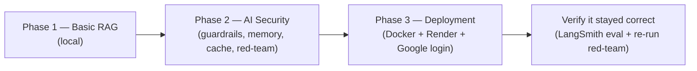

# 01. Overview & Problem

## The problem

Employees keep asking HR the same questions — *"How many leave days do I
get?"*, *"What's the notice period?"*, *"Can I work from home every day?"*
The answers all live in HR policy documents nobody wants to dig through.

The **HR Policy Assistant** is a chatbot that answers these by actually
reading the company's real HR policy documents and quoting from them — not
by guessing.

## Why this is harder than "just ask ChatGPT"

A generic model was never shown your company's policies. Two things have to
happen:

1. **Give the model the actual policy text** at answer time — this is
   **RAG** (Retrieval-Augmented Generation): find the relevant document
   first, then let the model answer using only that.
2. **Keep it honest and in-scope** — it must say "I don't know" when the
   answer isn't in the documents, and must refuse questions outside HR
   (company financials, other departments' data), even when asked cleverly.

## Who it's for

Any employee with a Google account on an approved list. They open a web
page, log in with Google, and ask in plain English.

## This is the free / local variant

The original course project ran on Google Cloud (Vertex AI Gemini, Model
Armor, Cloud Storage, Cloud Run, Secret Manager). This variant keeps the
**same design and the same file layout** but swaps every paid piece:

| Original | This variant |
|---|---|
| Vertex AI Gemini | Groq free tier (`gpt-oss-20b`, fallback `gpt-oss-120b`) |
| Vertex AI Model Armor | An LLM safety classifier (`GUARDRAIL_PROVIDER=llm`) |
| Google Cloud Storage | Plain folders on disk (`storage/raw`, `storage/processed`) |
| Jina embeddings + reranker | Local `fastembed` models (Jina optional) |
| Qdrant Cloud | Local on-disk Qdrant, or Qdrant Cloud's free cluster |
| Google Cloud Run + Secret Manager | Render (Docker) + a Render Secret File |
| Google OAuth login | **Unchanged** — Streamlit `st.login("google")` (free) |

The only key you must have is `GROQ_API_KEY`. Everything else is optional or
only needed for the Render deployment (doc 11).

## The stages this project goes through — one folder each

- **Phase 1** — a working local Streamlit/CLI app: read HR docs, embed them,
  store in a vector database, answer with a Groq model.
  (Docs 03–08.)
- **Phase 2** — made it *reliable*: safety guardrails, a scope filter, a
  semantic cache, short-term memory, an adversarial red-team pass.
  (Docs 09–10, 14–15.)
- **Phase 3** — made it a hosted product: containerized, deployed to Render,
  gated behind Google logins, every LLM call routed through one function
  (Groq primary, Groq larger-model fallback). (Docs 12–13, 16.)
- **Verify** — re-run the quality and safety checks against the deployed
  configuration. (Doc 10.)

## What "done" looks like

| Service | What it is | Who can reach it |
|---|---|---|
| `hr-rag-assistant` | The chatbot (Streamlit) on Render | Anyone can load the page; only approved employees who log in with Google can chat |

One Render web service. Model routing and fallback (doc 14) run inside it,
not as a separate service. Retrieval data lives in Qdrant Cloud, not on
Render (the free plan's disk is wiped on every sleep).

> Hit an error building or deploying? Every one that came up in this
> project — with the fix — is in **[doc 17 — Troubleshooting](17-troubleshooting.md)**.

Next: **[doc 02 — Tech Stack](02-tech-stack.md)**.
