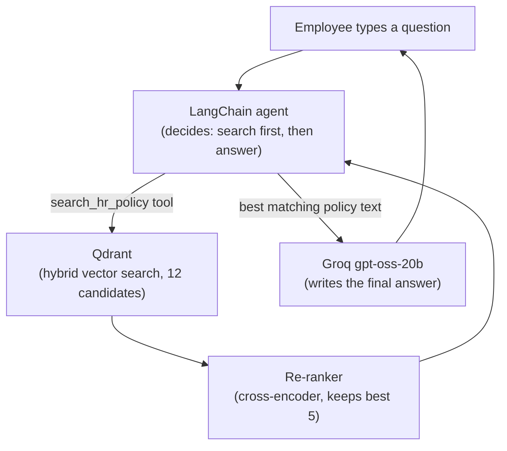

# 02. Tech Stack

In one sentence: **LangChain** wires the pieces together, a **Groq**-hosted
**gpt-oss** model writes the answers (**LiteLLM** falling back to a larger
model if it errors), **fastembed** (or **Jina**) turns text into searchable
numbers, **Qdrant** stores and searches them, **Streamlit** is the chat
window, **Docker + Render** is the hosting, and **Google OAuth + an LLM
safety check** keep it safe.

## How a question becomes an answer

## Components

| Component | Role | Why this one |
|---|---|---|
| **LangChain** (`langchain`, `langchain-core`) | Orchestration — the agent, the search-tool pattern (`create_agent` + `@tool`), deciding when to search vs. answer | Industry-standard pattern (LangChain 1.x) |
| **LangGraph** (`langgraph`) | Short-term memory (`InMemorySaver`) and a debuggable graph | LangChain's agent runtime is built on it |
| **Groq** (`gpt-oss-20b` primary, `gpt-oss-120b` fallback) | The models that read retrieved text and write the answer | Free tier, very fast, OpenAI-API-compatible. Needs only `GROQ_API_KEY` |
| **LiteLLM** (`litellm` + `langchain-litellm`, in-process) | The Router inside `hr_assistant/llm.py`: every model call asks for one logical model; LiteLLM routes it to the primary and falls back to the larger one after retries | One place to name backends + automatic failover, without a separate service — doc 14 |
| **fastembed** (`BAAI/bge-small-en-v1.5`; `Xenova/ms-marco-MiniLM-L-6-v2`; `Qdrant/bm25`) | Local embeddings, local cross-encoder re-ranker, and the keyword half of hybrid search | Free, runs on CPU, no account. Jina is a one-setting alternative |
| **Jina AI** (optional) | API embeddings + reranker when `EMBEDDING_PROVIDER` / `RERANK_PROVIDER = jina` | Smaller memory footprint — what the Render deployment uses. Free starting tokens, non-commercial |
| **Qdrant** (`qdrant-client`, `langchain-qdrant`) | The vector database — local on-disk, or Qdrant Cloud free tier | Native hybrid search + metadata filtering |
| **LLM safety guardrail** (`guardrails.py`) | Screens questions in and answers out for prompt injection, jailbreaks, unsafe content | Free replacement for Model Armor — see doc 15 |
| **Streamlit** | The web chat UI and the Google-login screen (`st.login` / `st.user`) | Python script → web app, with built-in Google OAuth |
| **Authlib** | The OAuth library Streamlit's `st.login()` uses under the hood | Required dependency for login |
| **Docker** | Packages code + dependencies into one portable image | Standard way to make "runs anywhere" |
| **Render** | Hosts the chatbot as one web service (free plan: 512 MB RAM, sleeps when idle) | Deploys straight from a Git repo, free tier, Secret Files |
| **Google OAuth** | Employee login | Free; no paid Google Cloud plan needed to create an OAuth client |
| **LangSmith** (`langsmith`) | **Tracing** (with `LANGSMITH_TRACING=true`) and **evaluation** (datasets + experiments for `evaluate.py`) | Optional — the app runs fine without it |
| **openevals** | The LLM-as-judge prompts the evaluation uses | Maintained by LangChain, plugs into LangSmith's `evaluate` |
| **Docker Compose** | Local run — `docker compose up` for the app, `docker compose run ingest` / `eval` for one-off jobs | Test the exact image before deploying |

## Libraries worth calling out

- **`fastembed`** — does three jobs locally: dense embeddings, the
  cross-encoder re-ranker, and the BM25 sparse model. The BM25 file needs a
  one-time download from HuggingFace, which can fail on a cold start in a
  container — so the Dockerfile fetches it at build time (doc 12).
- **`litellm`** — the heaviest import (roughly 280 MB of memory). It is why
  Render's 512 MB free plan is tight (doc 12).
- **`Authlib`** — without it, `st.login()` errors even if the secrets are
  right.

Next: **[doc 03 — Document Processing](03-document-processing.md)**.
