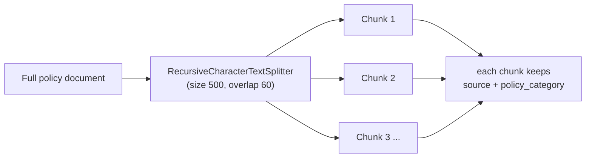
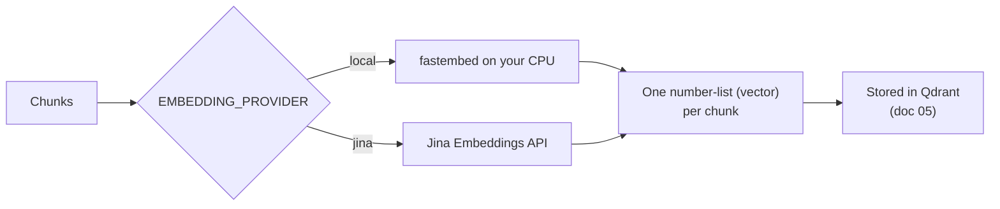

# 04. Chunking & Embeddings

Two steps that turn whole documents into something a computer can search.

## Chunking — cut each document into small pieces

A whole policy document is too big to search well. So each document is cut
into small overlapping pieces ("chunks"), about 500 characters each, with
60 characters of overlap so a sentence split across a boundary still makes
sense in both pieces (`CHUNK_SIZE = 500`, `CHUNK_OVERLAP = 60` in
`config.py`).



- **Too big** → retrieval gets vague, and you hand the model a lot of
  irrelevant text.
- **Too small** → you lose the surrounding context a question needs.
- The labels (`source`, `policy_category`) carry over onto every chunk
  automatically.

With the bundled data this gives **61 chunks** for the 10 HR policies and
**75** once the 8 non-HR documents are mixed in.

```python
from hr_assistant.splitter import split_into_chunks
chunks = split_into_chunks(documents)
```

## Embeddings — turn each chunk into a list of numbers

An **embedding** is a list of numbers that captures the *meaning* of a
piece of text. Two chunks about the same thing get similar number lists.
That's what makes "search by meaning" possible.

The original project used Jina's paid-after-trial API. This variant lets
you pick with one setting, `EMBEDDING_PROVIDER`:

| Provider | Model | Size | Cost / needs |
|---|---|---|---|
| `local` (default) | `BAAI/bge-small-en-v1.5` via `fastembed` | 384 numbers per chunk | Free, runs on your CPU, ~130 MB one-time download |
| `jina` | `jina-embeddings-v2-base-en` | 768 numbers per chunk | `JINA_API_KEY`; free starting tokens, **non-commercial** |



```python
from hr_assistant.embeddings import get_embeddings_model
model = get_embeddings_model()
vectors = model.embed_documents([c.page_content for c in chunks[:3]])
print(len(vectors), len(vectors[0]))   # 3 vectors; 384 numbers each (local) or 768 (jina)
```

## Watch out for

- **Never mix embeddings from two different models in the same store.**
  The question and the documents must be embedded by the *same* model or
  the "similar meaning = similar numbers" rule breaks silently. Different
  providers even produce different vector *lengths* (384 vs 768), so
  Qdrant will refuse the mix outright.
- **After changing `EMBEDDING_PROVIDER` or the model, run
  `python ingest.py --force`** to rebuild the collections.
- Embedding happens only in `ingest.py` (stable chunk IDs make re-ingestion
  an upsert, not a duplicate). `main.py` / `app.py` never re-embed
  documents — only the user's question.

Next: **[doc 05 — Retrieval & Vector Storage](05-retrieval-and-vector-storage.md)**.
