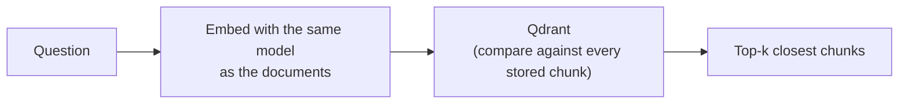

# 05. Retrieval & Vector Storage

## What "retrieval" means

Take the question, turn it into a number-list with the **same** model used
for the documents (doc 04), and ask the vector store for the chunks whose
number-lists are closest. Those are the most likely to answer the question.



## The vector store: Qdrant, two ways to run it

A **vector store** is a database built to do "find the closest number
lists" fast. This project uses **Qdrant**. A named set of vectors in
Qdrant is called a **collection**. The same code runs against either:

| Mode | Chosen by | Where the data lives | Good for |
|---|---|---|---|
| **Local** (default) | `QDRANT_URL` empty | Folder `qdrant_local/` on your disk — no account, no server | Laptop development |
| **Qdrant Cloud** (free 1 GB cluster) | `QDRANT_URL` + `QDRANT_API_KEY` set | Hosted cluster | Anything that must survive a restart — e.g. Render's free plan, whose disk is wiped on every sleep (doc 12) |

> **Local mode is single-process.** The on-disk database takes a lock, so
> only one program can open it at a time. If `ingest.py` is running, the
> app can't start, and the other way round. Qdrant Cloud has no such limit.

Adding chunks is an **upsert** (insert-or-update): re-ingesting the same
chunks overwrites them instead of making duplicates, because each chunk
gets a stable ID derived from its source + text (a deterministic UUID).

Two functions, kept apart on purpose:

- `build_vector_store(chunks, ...)` — embed + upsert. Only `ingest.py`
  calls this.
- `load_vector_store(name)` — connect to an existing collection, no
  embedding. `main.py` / `app.py` / `evaluate.py` connect this way; it
  raises a "run ingest.py" message if the collection isn't there (the
  `build_*_assistant` functions in `pipeline.py` catch that and bootstrap
  ingestion once).

```python
from hr_assistant.vector_store import load_vector_store, get_retriever

vector_store = load_vector_store()             # connect (no re-embed)
retriever = get_retriever(vector_store)
results = retriever.invoke("How many days of paid annual leave do I get?")
for r in results:
    print(r.metadata["source"], "-", r.page_content[:120])
```

## Two collections

| Collection | Contents | Used by |
|---|---|---|
| `hr_policies` | the 10 HR policy files only | the chatbot (`app.py`, `main.py`) and `evaluate.py` |
| `hr_policies_noisy_demo` | the same HR files **plus** 8 non-HR documents | the reliability demos / red-team (from Phase 2) |

## Watch out for

- The query **must** use the same embedding model as the documents.
- `k` too low → you miss a relevant chunk. `k` too high → you drown the
  model in noise. Re-ranking (doc 07) is what makes a wide `k` safe.
- A cluster URL copied from a template (e.g. `xxxx.cloud.qdrant.io`)
  fails with `Name or service not known` — see doc 17 (Phase 3).

Next: **[doc 06 — Metadata Filtering & Hybrid Search](06-filtering-and-hybrid-search.md)**.
