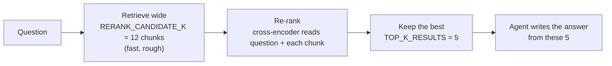

# 07. Re-ranking

(This page was an empty placeholder in the original project; it is written
out here.)

## The idea

Retrieval (docs 05–06) is **fast but rough**: it compares one precomputed
number-list for the question against one for each chunk. A **re-ranker** is
**slower but sharper**: it reads the question and a candidate chunk
*together* and scores how well that chunk really answers that question.

So the pipeline does both, in order — cast a wide net cheaply, then judge
the catch carefully:



## Why not just retrieve 5 in the first place?

Because the rough ranking sometimes puts the best chunk at position 7.
Retrieving only 5 would never show it to the model. Retrieving 12 and
re-ranking down to 5 rescues it — at the cost of one extra scoring step.

## Two providers, one setting (`RERANK_PROVIDER`)

| Provider | Model | Cost / needs |
|---|---|---|
| `local` (default) | `Xenova/ms-marco-MiniLM-L-6-v2` cross-encoder via `fastembed` | Free, runs on your CPU, small download |
| `jina` | `jina-reranker-v2-base-multilingual` | `JINA_API_KEY` (free starting tokens, non-commercial) |

## Scores: why the sigmoid matters

Jina returns a relevance score already between 0 and 1. The local
cross-encoder returns a raw **logit** — any real number, positive or
negative. `reranker.py` squashes it with a **sigmoid** so both providers
speak the same 0–1 language:

```
score = 1 / (1 + e^(-logit))

logit +5  ->  1 / (1 + 0.0067) = 0.993   strong match
logit  0  ->  1 / (1 + 1)      = 0.500   undecided
logit -5  ->  1 / (1 + 148.4)  = 0.007   unrelated
```

This matters from Phase 2: the **relevance threshold** (`0.35`) is a cutoff
on this 0–1 score. If even the best chunk scores below it, the assistant
answers "I don't have that" instead of stretching a weak match into an
answer (doc 15). The 0.35 value was tuned for Jina; with the local
cross-encoder treat it as a starting point and check it against real
questions (`demo_reliability.py` prints the scores).

```python
from hr_assistant.reranker import rerank_with_scores
ranked = rerank_with_scores("What is the notice period during probation?", candidates, top_n=5)
for doc, score in ranked:
    print(round(score, 3), doc.metadata["source"])
```

## Watch out for

- Re-ranking only re-orders the candidates it is given. If retrieval never
  fetched the right chunk into the 12, the re-ranker cannot find it.
- Changing `RERANK_PROVIDER` shifts the score scale — recheck the
  threshold.

Next: **[doc 08 — The Agent](08-the-agent.md)**.
