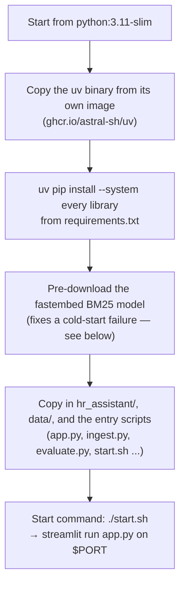
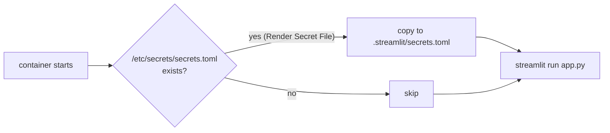

# 12. Containerization & Render

## What "containerizing" means

The app used to run only on one laptop with Python installed and a
hand-filled `.env`. **Docker** packages the app *and* everything it needs
(Python version, libraries, startup command) into one self-contained
**image**. Render takes that image's recipe (the Dockerfile) and runs it as a
live web service.

## The Dockerfile, in plain steps



- Dependencies install with **`uv`** (fast). `--system` because a container
  needs no separate virtualenv.
- `.dockerignore` keeps `.env`, `.streamlit/secrets.toml`, `storage/`,
  `qdrant_local/`, `results/` and `DEPLOYMENT/` out of the image — secrets
  never belong in an image.
- `data/` **is** in the image, so `docker compose run ingest` can ingest the
  corpus from inside the container.
- Render injects a `PORT` environment variable (default 10000); `start.sh`
  passes it to Streamlit with `--server.address=0.0.0.0`.

## What `start.sh` does at boot



Render mounts Secret Files at `/etc/secrets/<filename>`, but Streamlit reads
its login settings from `.streamlit/secrets.toml` — so `start.sh` copies the
file into place before the app starts. Without it, the app either runs in
open mode (local) or refuses to serve (`REQUIRE_AUTH=true`, as on Render).

## Running it locally with Docker Compose

`docker-compose.yml` is for testing the image *before* Render:

```bash
docker compose run --rm ingest   # one-off: fill the vector DB (once)
docker compose up --build        # the app at http://localhost:8501
docker compose run --rm eval     # one LangSmith evaluation run, then exit
```

All three read settings from `.env` through `env_file`.

> **`env_file` is read only when a container is created.** If you edit
> `.env` while a container is running, nothing changes inside it. Run
> `docker compose down`, then `docker compose up` (or `up --force-recreate`)
> to pick up the new values. This caused a real "I fixed the URL but the
> error is still there" episode (doc 17 §5).

With no Streamlit `[auth]` secrets in the container, the local app runs in
"open local mode" (no login) — a yellow warning in the sidebar says so.

## Why Render uses Jina + Qdrant Cloud, not the local models

The free Render instance has **512 MB of RAM** and an **ephemeral disk**
(wiped on every restart or sleep). So:

| Piece | Local run | On Render free |
|---|---|---|
| Embeddings | `fastembed` on CPU (~130 MB model) | Jina API (no local model in RAM) |
| Re-ranker | `fastembed` cross-encoder | Jina API |
| Vector DB | `qdrant_local/` folder | Qdrant Cloud (a folder would vanish at sleep) |

This is all driven by environment variables in `render.yaml`
(`EMBEDDING_PROVIDER=jina`, `RERANK_PROVIDER=jina`, `QDRANT_URL=…`) — the
code is identical. A paid instance with a persistent disk could run the fully
local setup by changing those variables back.

## The deploy

```bash
git init && git add . && git commit -m "hr rag on render"
git remote add origin https://github.com/<you>/<repo>.git
git push -u origin main
```

Render dashboard → **New → Blueprint** → select the repo. Render reads
`render.yaml` and creates one Docker web service on the **free** plan, then
prompts for the values marked `sync: false`: `GROQ_API_KEY`, `JINA_API_KEY`,
`QDRANT_URL`, `QDRANT_API_KEY`, `ALLOWED_EMPLOYEE_EMAILS`.

- `REQUIRE_AUTH=true` is preset — see doc 13.
- `healthCheckPath: /_stcore/health` is Streamlit's built-in health endpoint.
- `autoDeploy: true` — every `git push` redeploys.
- **Secret Files cannot be declared in `render.yaml`.** After the first
  deploy, add `secrets.toml` in the dashboard: service → **Environment** →
  **Secret Files** (doc 13).

## Free-plan behaviour to expect

- **Sleeps after ~15 minutes idle.** The first request afterwards takes about
  30–60 s to wake the service.
- **In-process state resets** on every sleep or restart: the semantic cache
  and every user's chat memory start empty. Data in Qdrant Cloud is unaffected.
- **Memory is tight.** The Python process imports roughly 330 MB, of which
  `litellm` alone is about 280 MB, plus Streamlit and per-session state. Even
  Render's next paid tier is also 512 MB, so "just upgrade" is not an
  automatic fix; check the Memory graph in the dashboard's **Metrics** tab and
  the **Logs** for "Out of memory". The remedy that helps is removing
  `litellm` (doc 14).

## A cold-start bug worth knowing

Hybrid search needs a small BM25 model. `fastembed` downloads it from
HuggingFace the first time it is used, and a fresh container keeps no disk
between runs — so a rate-limited download can crash a cold start with
`ValueError: Could not load model Qdrant/bm25 from any source.` The fix is
the Dockerfile line that moves the download to *build* time:

```dockerfile
RUN python -c "from fastembed import SparseTextEmbedding; SparseTextEmbedding(model_name='Qdrant/bm25')"
```

Classic "worked on my laptop" bug — the laptop kept its downloaded files.

Full command list: **`commands/commands-deployment.md`**. Errors: **[doc 17](17-troubleshooting.md)**.

Next: **[doc 13 — Access Control](13-access-control.md)**.
