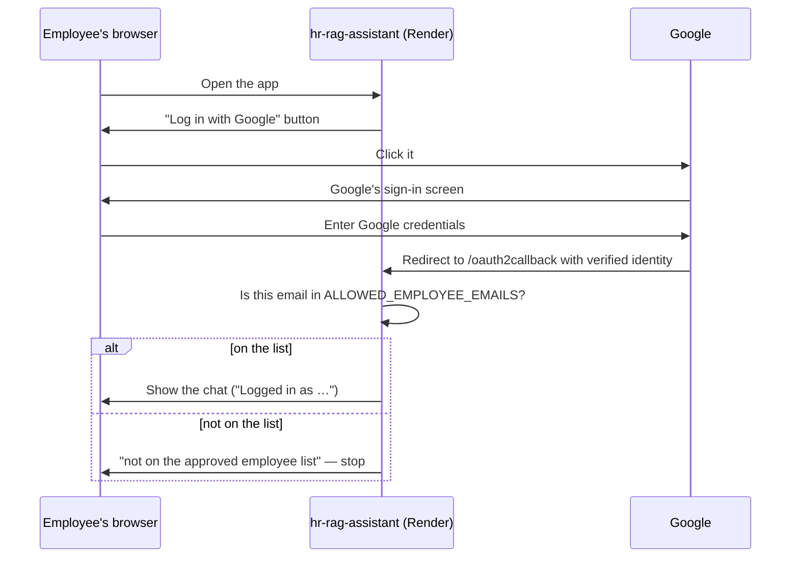
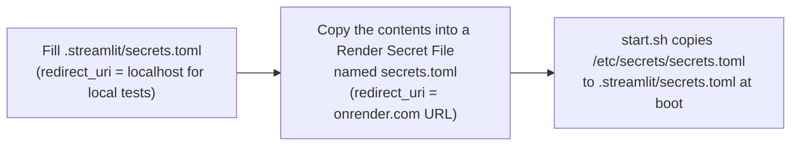

# 13. Access Control (Google Login + Allow-List)

## The goal

Only actual employees on an approved list should ever chat with the
assistant. Everyone else sees a login screen and gets no further. This also
protects your free Groq quota from the whole internet.

## Why Render itself isn't the gate

A Render web service is reachable by anyone with the URL. There is no
network-level login to put in front of it on the free plan. So instead:

- The service is **public** — anyone can load the page.
- The **app itself** decides who gets past the login screen.

## The login flow



**Two independent checks must both pass:**

1. **Google's consent screen in "Testing" mode** — while the OAuth consent
   screen is in *Testing*, Google itself only lets an email log in if it is
   on the **Test users** list in the Cloud Console. This happens on Google's
   side, before the app sees anything.
2. **The app's own `ALLOWED_EMPLOYEE_EMAILS` list** — a second check inside
   `app.py` (emails are lower-cased and compared). Even a valid Google test
   user is rejected here if their email isn't listed.

Same emails in both lists, enforced by two unrelated systems on purpose —
belt and suspenders. Creating the OAuth client costs nothing; no paid Google
Cloud plan is needed.

## Fail-closed: `REQUIRE_AUTH`

`app.py` has three states:

| Situation | What the app does |
|---|---|
| `[auth]` secrets present | Enforce login + allow-list |
| No secrets, `REQUIRE_AUTH=false` (default, local) | "Open local mode" — no login, sidebar warning |
| No secrets, `REQUIRE_AUTH=true` (Render) | **Refuse to serve**: "This deployment requires Google login, but the [auth] secrets are not configured" |

The third row is deliberate. If someone forgets the Secret File on a public
URL, the safe failure is "blocked", not "open to the world". Seeing that
message right after the first deploy is **expected** — it means the guard works.

## The `secrets.toml` layout

`app.py` calls `st.login("google")` — a **named** provider — so the Google
credentials must sit under `[auth.google]`; only the shared settings sit
under `[auth]`:

```toml
[auth]
redirect_uri  = "https://<your-service>.onrender.com/oauth2callback"
cookie_secret = "<long random string>"

[auth.google]
client_id           = "<id>.apps.googleusercontent.com"
client_secret       = "<secret>"
server_metadata_url = "https://accounts.google.com/.well-known/openid-configuration"
```

A flat `[auth]` block that holds `client_id` directly fails with
*"Authentication credentials … are missing for the authentication provider
'google'"* (doc 17 §2). `.streamlit/secrets.toml.example` has this layout.

- **`cookie_secret`** signs the "stay logged in" cookie so it can't be
  forged. It is any long random string you invent, for example
  `python -c "import secrets; print(secrets.token_hex(32))"`. Changing it
  just logs everyone out.
- **`client_id` / `client_secret`** come from Google Cloud Console →
  APIs & Services → Credentials → Create OAuth client ID (type *Web
  application*), or from the JSON you can download for that client.

## Where the file lives



The local file and the Render one differ in exactly one line, `redirect_uri`.
Neither is ever committed.

## `redirect_uri` — two rules that cause almost every OAuth failure

- It **must end in `/oauth2callback`** — the only path Streamlit's login
  handler listens on. A bare URL makes login silently loop.
- The string must match a URI on the OAuth client's **Authorized redirect
  URIs** list **character-for-character** (`https`, no trailing slash, exact
  host). A mismatch is `Error 400: redirect_uri_mismatch`.

Register both `https://<your-service>.onrender.com/oauth2callback` and, for
local testing, `http://localhost:8501/oauth2callback`.

## Chicken-and-egg: you learn the URL after the first deploy

1. Deploy once with the environment variables only (the app shows the
   fail-closed message).
2. Copy the service URL from the Render dashboard.
3. Add `<url>/oauth2callback` to the Google OAuth client's redirect URIs.
4. Add the `secrets.toml` Secret File with that same `redirect_uri` — saving
   it redeploys the service.
5. Reload: "Log in with Google" appears.

## Adding or removing an employee

Two steps, because two systems enforce access:

1. **Google Cloud Console** → OAuth consent screen / Audience → add or remove
   the email under **Test users**.
2. **Render** → Environment → edit `ALLOWED_EMPLOYEE_EMAILS` (comma-separated
   list) — saving redeploys.

Miss either step and that person is blocked. (A made-up address can sit in
the allow-list harmlessly, but nobody can log in as it — handy for testing
the "rejected" path only with a *real* second account.)

Next: **[doc 14 — LLM Routing & Fallback](14-llm-routing.md)**.
