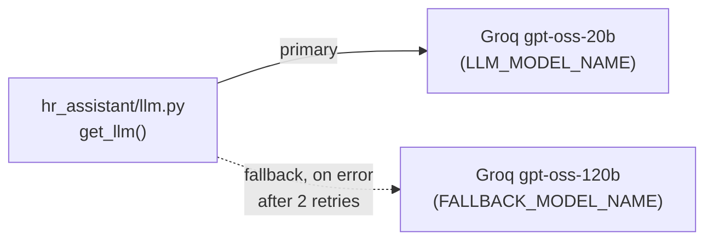

# 14. LLM Routing & Fallback

## Why put anything between the app and the model

The app could call one Groq model directly. That works until the call
fails — a rate limit on the free tier, a regional blip, a 5xx. Then the
whole request dies, even though a perfectly good second model exists.

So every model call goes through **one function**, `get_llm()` in
`hr_assistant/llm.py`, which returns a chat model backed by a **LiteLLM
Router**:

The calling code (`agent.py`, `guardrails.py`) only ever asks for one
logical model. The Router decides what serves it. Swapping or reordering
backends is a change in `.env` (or `llm.py` + `config.py`) and nowhere else.

## Primary + fallback

`hr_assistant/llm.py` builds a `litellm.Router` with two deployments:

- **primary** — `groq/openai/gpt-oss-20b` (`LLM_MODEL_NAME`): small and fast.
- **fallback** — `groq/openai/gpt-oss-120b` (`FALLBACK_MODEL_NAME`): larger,
  used only after the primary errors `num_retries` (2) times.

Both are full LiteLLM strings, `"<provider>/<model>"`. Moving to another
provider — Gemini through Google AI Studio, a model served by Ollama on your
own machine — is an `.env` change, not a code change (that provider's own key
variable, such as `GEMINI_API_KEY`, must be set).

`litellm.drop_params = True` so a parameter one backend accepts but another
rejects doesn't 400 the fallback.

`langchain-litellm`'s `ChatLiteLLMRouter` wraps the Router as a normal
LangChain chat model — tool calling and structured output both work, so the
agent and the safety guardrail use it unchanged.

> **Both models are on Groq**, so this protects against a model-level
> error or a per-model rate limit, **not** against Groq itself being down or
> your key being revoked. For true provider failover, point
> `FALLBACK_MODEL_NAME` at a different provider.

> **Models get retired.** Groq's catalogue changes. If a call fails with
> "model not found", choose a current one from console.groq.com/docs/models
> and set it in `.env`.

## LiteLLM: SDK, not a proxy service

LiteLLM has two forms. The **SDK** (used here) is a library that runs
in-process. The **proxy** is a separate server that many apps call over
HTTP, adding a shared dashboard, per-team budgets, and virtual keys. With a
single app, the proxy buys nothing the in-process Router doesn't already
give: provider-agnostic calls and automatic failover. Central observability
is covered by LangSmith tracing (doc 10).

> **Cost of the SDK: memory.** Importing `litellm` is the single largest
> item in the app's footprint (roughly 280 MB of a ~330 MB import total in
> my measurements). That is fine on a laptop and is the main pressure point
> on Render's free 512 MB plan (doc 12). Replacing it with a direct Groq
> client would cut most of that, at the price of writing the retry/fallback
> loop yourself.

Next: **[doc 15 — Content Guardrails](15-content-guardrails.md)**.
