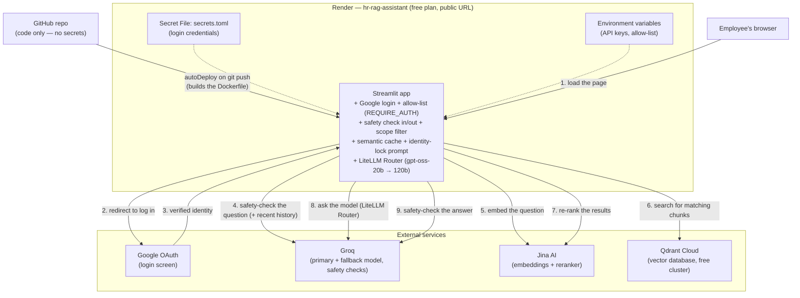

# 16. Full Hosting Architecture

Every piece from docs 01–15 in one picture. One Render web service, plus
four outside services it talks to.

*Steps 4 and 9 run before the semantic-cache lookup and after generation
respectively. On step 4 a flagged question stops there; a cache hit after
step 4 skips straight to the answer, past steps 5–8.*

## Reading the diagram

- **Solid arrows** — the live path for one question, in order.
- **Dashed arrows** — configuration injected at startup.
- **`hr-rag-assistant`** is the only service you deploy. Public at the
  network level, gated by Google login + the allow-list before anything works.
- **Model routing** (primary, then a larger fallback) is the LiteLLM Router
  *inside* that service, not a separate deployment — doc 14.
- **Groq appears three times**: the answering model, the fallback, and the
  safety classifier — all one free key, one shared rate limit (doc 17 §9).
- **Qdrant Cloud holds the knowledge.** The Render disk is ephemeral, so
  nothing important lives on it.

## The one service

| | `hr-rag-assistant` |
|---|---|
| Who can reach it | Anyone (network) — gated by app login |
| What enforces access | Google OAuth + `ALLOWED_EMPLOYEE_EMAILS`, fail-closed by `REQUIRE_AUTH=true` |
| Its guardrails | Safety check in/out, scope filter, identity lock, semantic cache |
| Talks to the model | Groq, through the in-process LiteLLM Router |
| Plan limits | 512 MB RAM, sleeps after ~15 min idle, no persistent disk |

## Where each secret lives

| Secret | Lives in |
|---|---|
| Google client ID / secret / cookie key / redirect URI | Render **Secret File** `secrets.toml` |
| Groq, Jina, Qdrant API keys; allow-list | Render **Environment variables** |
| Non-secret config (`REQUIRE_AUTH`, model names, providers) | `render.yaml` |
| Nothing | GitHub — `.env` and `secrets.toml` are git-ignored |

## What each part costs

| Part | Free-tier limit to keep in mind |
|---|---|
| Render free | 512 MB RAM, cold start after idle |
| Groq free | Per-minute/day token limits — each question costs the answer call plus two safety calls |
| Jina | Free starting tokens, non-commercial |
| Qdrant Cloud free | 1 GB cluster (this project uses a tiny fraction) |

That's the whole system. See **`commands/commands-deployment.md`** to build
it, and **[doc 17 — Troubleshooting](17-troubleshooting.md)** for every error
that came up along the way.
